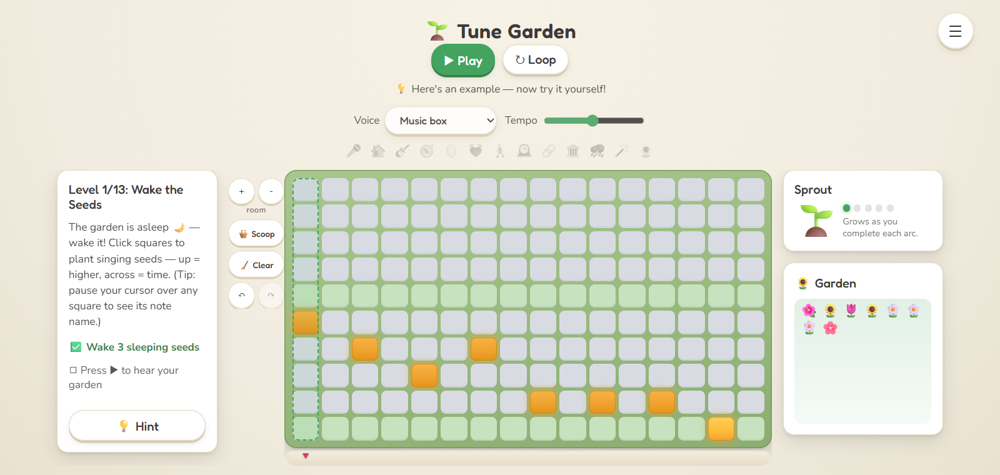

# 🌱 Tune Garden

[](https://github.com/pad29/music-garden/actions/workflows/checks.yml)

A browser game that teaches music theory through play — **"Minecraft for music."** Players compose real-sounding music by placing simple visual elements and *feel* musical concepts (tension, resolution, harmony, contour, pulse) long before they meet the names. Audience skews to children 8+, but is meant to appeal broadly.

**Play it at [tunegarden.game](https://tunegarden.game/)** — in the browser, with nothing to install and no account needed (an optional account syncs your progress across devices and shares songs too big for a link).



**Run it yourself** — no build step, no dependency; with [Git](https://git-scm.com/) and [Node.js](https://nodejs.org/), run these and open http://localhost:8377 (or skip the server and open `music-garden/index.html`):

```bash
git clone https://github.com/pad29/music-garden.git
npx http-server music-garden -p 8377 -c-1
```

**Licence:** code under the [GNU AGPL-3.0-or-later](LICENSE); narration audio and docs under [CC BY-SA 4.0](LICENSE-CC-BY-SA.md); the name "Tune Garden" and its logo not licensed. Samples, fonts and famous melodies keep their own terms: [CREDITS.md](CREDITS.md).

**Contribute:** [CONTRIBUTING.md](CONTRIBUTING.md) says how to report a bug, propose a change and open a pull request. Everyone follows the [code of conduct](CODE_OF_CONDUCT.md); a security problem is reported privately, as [SECURITY.md](SECURITY.md) says.

---

**For developers**, the rest of this README is the working map: how to run the checks, where everything lives, the conventions, and what is built. The live site deploys from `main` on every push ([Deployment](#deployment)).

> Status: working browser game (no dependencies, no build step), in active development. **20 packages built** across 7 regions (the 13-level intro + 19 expansion packages, including the full Weather of Wanting harmony arc), the first two **quests** (*The Firefly Crossing*, *The Waking Woods*), Studio + cloud song sharing, spoken narration, a famous-melody Jukebox, an interactive world map, and seven sampled instrument voices. Backend deployed. See **[Current status](#current-status--whats-next)**.

---

## Quick start

The whole game is **`index.html`** — the page's markup and styles — and the classic scripts in **`js/`** that it loads, which hold all of the game's code (vanilla JS + Web Audio, no dependencies, no build step), plus three runtime asset folders (`voice/` narration clips, `samples/` instrument packs, `vendor/` fonts and the sign-in library).

- **Run it:** open `index.html` directly in a browser (file:// works — the game is built to survive it), **or** serve the folder:
  ```bash
  npx http-server -p 8377 -c-1 .
  # then open http://localhost:8377
  ```
  In an AO session, `ao preview start` serves the session's worktree instead, on a loopback port AO picks (`.ao/launch.json`); `.claude/skills/work-ticket/browser.md` says how a worker opens and checks it.
- **Syntax-check the game's scripts** (the fastest check — run after every edit):
  ```bash
  node tools/check-syntax.mjs
  ```
- **Run the tests** (zero dependencies — Node's built-in runner, nothing to install):
  ```bash
  node --test "tests/*.test.mjs"
  ```
  It covers the game's logic — detectors and pulses, meter and grooves, persistence, pinch and zoom, the script load order, the quest engine, the backend's validator and handlers — by loading the game into a stubbed-DOM vm context, and cannot reach rendering or audio. Read `tests/README.md` before writing one.
- **Dev URL flags:** append `?dev` to reveal package and level-jump dropdowns (the package list's *Studio* opens the Studio, as the map's ▶ Open Studio does — TUN-69), "🔒 Relock instruments" (replays the region discovery cards without touching progress), "🗝️ Unlock quests" (marks every quest's prerequisite packages complete, so its Home card appears without playing them) and "🧹 Clear quest runs" (deletes every quest run and completion record, so the quests are unplayed again); `?reset` asks first, then wipes local progress and quest runs (saved melodies stay) — a link is something a stranger can send, so it never wipes unasked — and either answer takes `reset` out of the address bar, so a reload doesn't ask again.
- **⚠️ file:// constraint:** the game must keep working when `index.html` is double-clicked. That means **no `fetch()`/XHR for local assets** — runtime data loads via `<script src>` tags (see `samples/*.js`) or `Audio` elements (`voice/*.mp3`) — and the game's own code in `js/` is **classic scripts, never ES modules**, which do not load from file://. Cloud APIs (https) are exempt.

---

## Repository map

| Path | What it is |
|---|---|
| **`index.html`** | The page: markup and styles, and the `<script src>` tags that load the game's code from `js/`, in order. It holds no game code of its own, and names no other site: its fonts and the sign-in library come from `vendor/`. With `js/`, the source of truth for the app. |
| **`js/`** | The game's code: 29 classic scripts that `index.html` loads with `<script src>` tags, in order — `js/load-gate.js` first, `js/boot.js` last. See [How the game's code is organized](#how-the-games-code-is-organized) for which sections live in which file. |
| **`LICENSE`**, **`LICENSE-CC-BY-SA.md`**, **`CREDITS.md`** | The licences (TUN-89): `LICENSE` is the AGPL-3.0 text, byte for byte, for the code; `LICENSE-CC-BY-SA.md` puts the narration clips and the docs under CC BY-SA 4.0. `CREDITS.md` is the map of what is under which licence, the copyright line, and the credit for every sample pack, font, library, narration clip and famous tune — the build publishes it with both licence files, and the map footer links it. `tests/licences.test.mjs` fails when a `FAMOUS` tune or a sampled voice has no credit row. |
| **`CONTRIBUTING.md`**, **`CODE_OF_CONDUCT.md`**, **`SECURITY.md`** | For people who contribute (TUN-92): how to run and test the game, which doc to read for which change, the rules in plain words, how to propose a change, the sign-off, and what happens to a pull request; the Contributor Covenant 2.1; how to report a security problem privately. Conduct reports go to `conduct@tunegarden.game` (a forwarding alias), which is also security's fallback after GitHub's private reporting. `CONTRIBUTING.md` restates `AGENTS.md` § Commands and § Hard invariants — `tests/contributing.test.mjs` fails when they drift apart. |
| **`REQUIREMENTS.md`** | Product requirements & pillars. |
| **`DESIGN.md`** | High-level design — the "musical physics" engine, crafting tree, play modes, the full feature log (everything built, dated). |
| **`PACKAGES.md`** | The package **catalog / dependency graph (DAG)**: regions, capability clusters, the spec template, shared vocabularies, and the high-level package specs with build status. |
| **`PACKAGES-DETAILED.md`** | Level-by-level as-built specs for every shipped expansion package, plus the **difficulty-ramp doctrine** every package follows. |
| **`EDITOR-DESIGN.md`** | The **long-term editor design**: notes-as-objects + lens architecture, the chromatic lattice with lighting-as-tonality (draggable HOME + mode switch), duration/dynamics/multi-voice/sections plans, and the build phases that unblock the remaining package waves. |
| **`SAVE-SHARE.md`** | The save/share system spec (pitch-based v3 song format, Studio, cloud songs) — **implemented** (P1–P3). |
| **`QUESTS.md`** | The **quest play mode**: vocabulary, the declarative quest schema, the ordered quest kinds, and the decision record. **Kind 1 ships**, in two quests (*The Firefly Crossing*, *The Waking Woods*) — reachable from the world map. Kinds 2–9 are still intent. |
| **`MAKING-QUESTS.md`** | How a contributor **adds a quest** as data: the definition field by field (*The Waking Woods* annotated), the closed lists it draws on, witnesses, checking it with `tools/quest-catalog.mjs`, trying it with `?dev`, and what makes a good quest. Its tables are held to the engine by `tests/quest-guide.test.mjs` (TUN-105). |
| **`voice/`** | Pre-baked narration mp3s (Amazon Polly), one per spoken line, keyed by text hash. Regenerate with `tools/gen-voice.mjs` after changing any `intro:`/`credit:` text. |
| **`samples/`** | Sampled-instrument packs. `samples/<instr>/*.mp3` are the source recordings; `samples/<instr>.js` is the base64 pack the game actually loads (script-tag, file://-safe). Rebuild with `tools/build-samples.mjs`. |
| **`vendor/`** | Third-party files the game serves from its own site, because the page makes no third-party requests (TUN-81): the Cognito sign-in library (`amazon-cognito-identity-js` 6.3.22) and the Fredoka and Nunito fonts (`woff2`, with Google's `@font-face` rules in `fonts/fonts.css`), copied as released, with their licences. `SHA256SUMS` pins every file. Versions, sources and how to update: `vendor/README.md`. |
| **`tools/`** | Node build scripts: `gen-voice.mjs` (Polly narration clips — needs AWS creds), `build-samples.mjs` (packs sample mp3s into loadable JS), `check-syntax.mjs` (syntax-checks every script the game loads), `quest-catalog.mjs` (extract, check and install the built-in quest catalog — `MAKING-QUESTS.md`). |
| **`backend/`** | AWS SAM backend (Cognito auth + per-user progress API + cloud songs API on DynamoDB). `template.yaml`, `src/*.mjs`, `README.md` (deploy guide), `samconfig.toml`. |
| **`cloudflare-build.sh`** | The deploy build — Cloudflare Pages' dashboard runs `sh cloudflare-build.sh`, output `site`: copies `index.html` + `_headers` + `CREDITS.md` + the two licence files + `js/` + `voice/` + `samples/` + `vendor/` into a fresh `site/`. **Add any new runtime asset folder here** — a missing `js/` file is served as `index.html` and stops the game from starting. Kept to a strict copy-only form; `tests/cloudflare-publish.test.mjs` pins it and runs it. See [Deployment](#deployment). |
| **`_headers`** | The response headers the site sends (TUN-86): the content security policy, no framing, `nosniff`, the referrer policy, and the cache rules. The build copies it into `site/`, where Cloudflare Pages reads it. `tests/site-headers.test.mjs` pins it. See [Deployment](#deployment). |
| **`reviews/`** | One file per ticket: the design (GPT's, or Claude's plan with GPT's review of it, by the ticket's size), what GPT's test pass and the PR review flagged, and what was done. See `reviews/README.md`. |
| `REVIEW-LOG.md` | The same record for everything before 2026-09-28, in one file — closed, kept as history. |
| `.claude/` | The Claude/GPT workflow, run through Agent Orchestrator: the skills (`work-ticket` — with the procedure files beside it that a worker reads only when their step comes up: `resume.md`, `browser.md`, `needs-input.md`, `pr-review.md`, `handoff.md` — `file-ticket`, `gpt-design`, `gpt-review`, `gpt-spec`), GPT's briefs, its `ask.sh` wrapper and `gpt-lock.sh`, the one-GPT-job-at-a-time lock (`gpt/`). The policy is `CLAUDE.md`; what every agent must know is `AGENTS.md`. |
| `.ao/launch.json` | AO's preview config: `ao preview start` runs `http-server` in the session's worktree, bound to `127.0.0.1` on a port AO picks, at `index.html?dev`. Keep it to one configuration — with several, a bare `ao preview start` refuses to choose — and valid throughout: one bad entry makes AO reject them all. `tests/ao-launch.test.mjs` pins those rules; a worker's use of it is `.claude/skills/work-ticket/browser.md`. |
| `.github/` | GitHub's files. `workflows/checks.yml` — GitHub Actions: the syntax check and the tests on every PR and every push to `main` (TUN-90) — read-only, no secrets, nothing installed, actions pinned to commits, safe for PRs from forks; `tests/ci-workflow.test.mjs` pins those rules. `ISSUE_TEMPLATE/` (*Bug* and *Idea*, blank issues off, links to private security reporting and `CONTRIBUTING.md`) and `pull_request_template.md` (the checks run, what the owner must do, the sign-off) — TUN-92; GitHub uses them once they are on `main`. `screenshot.png` is the README's screenshot (TUN-98). |
| `site/` *(gitignored)* | The build output dir (generated by `cloudflare-build.sh`). |
| `archive/` *(gitignored)* | Feedback/brainstorm/brand source docs (`*.docx`) and finished hand-off briefs — decisions from them are folded into the `.md` files. Kept on disk, not in the repo. |

**Read order for picking up development:** this README → `DESIGN.md` (vision + what's built) → `PACKAGES.md` (the map & conventions) → `PACKAGES-DETAILED.md` (as-built level specs) → `SAVE-SHARE.md` (song format) → `EDITOR-DESIGN.md` (where the editor is headed) → then the `js/` files you're touching ([the map below](#how-the-games-code-is-organized) says which).

---

## How the game's code is organized

`index.html` is the page — markup and styles — and holds no game code. The game's code is one run of sections, each opened by a `// ---------- … ----------` landmark (search for these), split across classic script files in `js/` that `index.html` loads **in this order** (TUN-6 moved the first five out of the page's inline script, TUN-7 the rest). Just before them the page loads one script that is not game code, the Cognito sign-in library from `vendor/` (TUN-81): the tools list it apart (`vendored` in `tests/helpers/game-scripts.mjs` — compiled by the syntax check, never run by the harness), and the load gate ignores it, so without it the game runs guest-only.

| File | Sections |
|---|---|
| `js/load-gate.js` | **Must stay first.** The load gate: holds every kind of player input back until all the game's scripts have run, and notices one that failed to load (`LOAD_GATE_EVENTS`, `gameScriptsLoaded`, `openLoadGate`) |
| `js/palettes.js` | Music model: palettes (`PALETTES`, `setPalette`, `MIDI`/`NAMES`, `COLS`/`ROWS`, `grid`) · Tools (`widthBand`, `stableMidis`, `pairMeta`, `toolMeta`) with their real note/interval/chord names (`chordName`, `intervalName`) · the toolbox state |
| `js/audio.js` | The audio engine (`initAudio`, the mixer buses, `applyMix`) · sampled voices (`SAMPLED`, `loadSamples`, `sampleVoice`, `ringCeiling`) · `voice`, `playRow` |
| `js/band.js` | Jam backing (`bTone`/`kick`/`snare`/`hat`, `GROOVES`, `grooveFits`, `normalizeGroove`) · the band as data (`groovePlan`, `jamStep`) |
| `js/drums.js` | The drum sequencer (`DRUMS`, `drumG`, `buildDrums`, `drumClick`, `placeDrums`) |
| `js/doc-model.js` | The document model (`doc`, `freshDoc`, ticks and note IDs) · meter (`METERS`, `pulsesIn`, `meterLayout`, the beat tint) · the projection (`projectTracks`, `reproject`) · the undo journal (`tx`, `snapState`, `restoreSnapshot`, undo/redo) · model operations and time surgery · autosave |
| `js/grid.js` | The grid (`cells`, `buildGrid` — run once at load) · the hover note-name tip · the camera (`CAM`, `camEnsure`, `camTo`, `camReseed`) · zoom (`setFieldZoom`, `cycleZoom`, `lookOnly`) · pinch and the zoom tap (`armPinch`, `armZoomTap`) · the vine layer (`renderVines`) |
| `js/editing.js` | Pulling a vine · 🌿 Grow / ✂ Trim (`growTrim`) · field rebuilds (`rebuildField`, `addColumns`, `removeColumns`, `setCell`) · plant / fuse / stamp (`cellClick`, `craftFromCells`, `fusePick`, `fuseField`, `stampTool`) · the 🎒 Toolbox UI (`renderBag`, `toggleStamp`) |
| `js/tray.js` | The seed tray, 🧺 Scoop: select / move / copy / delete / transpose and time surgery (`enterTray`, `exitTray`, `trayMove`, `trayPaint`, `TRAY_CW`) |
| `js/cursor.js` | The cursor and the loop range (`cursorCol`, `loopStart`, `syncCursor`, `pinCursor`) · bar chips (`renderBars`) · the ☰ menu (`setSideMenu`) · the two lanes' scroll mirror, `showDrumArea` · ＋/－ room at the cursor |
| `js/goal-helpers.js` | The "Levels" landmark: what every goal's `chk(state, ev)` reads (`gridState`, `freshEv` and `ev`) · Twin Blooms (Plus) pair helpers (`pairTension`, `tensionThenRest`) · Standing Towers (`colStands`) · tool counts · echo / call helpers (`echoMatch`, `echoHint`, `playPhrase`) |
| `js/famous.js` | The famous library (`FAMOUS`, `FAMOUS_TEMPO`) and its capstone reveal (`placeFamous`, `playFamous`, `revealFamous`) |
| `js/detectors.js` | The per-package detectors, one landmark per package: contour (`contourSeq`, `isRising`…), motion, motifs, pulse and density (`setBeatGuide`, `drumHits`…), duration, the F/B colour reveal (`isLockedRow`), phrase Q&A, cadence, mood, progressions (`CHORDS`, `chordSyms`…), inversions, graded tension · the compare pickers (`showChoices`…) |
| `js/packages.js` | The surprise reveals the intro's arcs fire (`runReveal`, `structureReveal` — first, because `PACKAGES` names one as it loads) · `PACKAGES`, every package and level · `PACKAGES.studio` · `widestPalette` |
| `js/completion.js` | Completion sessions: proof that a pass was heard (`reduceCompletionSession`, `completionDispatch`, `beginCompletionSession`), and the quest receipt it hands on (`onCompletePass`) |
| `js/quest-catalog.js` | The sealed quest catalog: the plain-JSON gate and the closed grammar (`assertPlainJsonTree`, `QT`, `QUEST_SCHEMA_V1`…`V3`, `questCrossRefs`) |
| `js/quest-engine.js` | What the engine can look for (`songEvidence`, `questRegistry`, `QUEST_PRIMITIVES`, `QUEST_DESCRIPTORS`, the capability / control / tool / transition / payoff / theme registries, the generated tasks `QUEST_SETUP_KINDS`, readiness, `questSemantics`) · what the garden says back (`evaluateQuest`, `questRenderTokens`) · `loadQuestCatalog` and the built-in catalog JSON |
| `js/quest-run.js` | The QuestRun and its persistence (`reduceQuestRun`, `saveQuestRuns`, `hydrateQuestRuns`) · the phase gate and the offering (`questPhaseGate`, `finalizeQuestOffering`) · entering a quest (`enterQuestRun`, `performQuestAction`) · who may begin, and the Home card (`questEligibility`, `questHomeCard`) |
| `js/quest-shell.js` | The quest shell (`questShellModel`, `renderQuestShell`, `leaveQuest`, `startQuestRun`, `transactQuestRun`) · the finale |
| `js/play-scope.js` | The play scope (`setPlayScope` — first called at load — `activeScope`, `curStage`, `scopeFeatures`, `restoreLastPackage`, package unlocks) · **read-aloud narration** (`narrate`, `speakOn`, `voiceHash`, `enterPlay`) |
| `js/level-engine.js` | The level engine (`renderLevel`, `renderStage`, `checkLevel`, `stageComplete`, `resetTransient`) · power cards and the package-complete congrats · the world strip · companions (`COMPANIONS`, `REGIONS`, `REGION_MAP`) · the Next button |
| `js/playback.js` | Playback controls (`instrEl`, `tempoEl`, `setVoice`) · the gradual instrument reveal (`REGION_INSTR`, `INSTR_INFO` — narrated) · the Transport lookahead scheduler (`bookColumn`, `pump`, `start`, `stop`) · the click · the control wiring (▶, Jam, groove, meter…) · keyboard shortcuts |
| `js/helpers.js` | The status line (`setStatus`, `setStatusText`), `toast`, `confetti` · **starter content and the 💡 Hint button** (`setMelody`, `setMelodyLens`, `hintMelody`) |
| `js/persistence.js` | The `Store` seam, and `progress` (read from storage at load) · `commitProgress`, `saveUserSettings`, `savePackageProgress` · the per-scope toolbox (`loadScopeToolbox`) |
| `js/save-share.js` | Save & Share: the v3 song format (`currentSong`, `applySong`, `encodeSong` / `decodeSong`), share links, My Melodies and the Jukebox list (`JUKEBOX_FAMOUS`, `openMelodies`) · the 🎚️ Mixer |
| `js/home.js` | Home / profile (`openHome`, `renderQuestHome`, `openPkg`, `openStudio`) · the continent map (`CONTINENT`, `renderPkgs`, `splitPolyN`) |
| `js/garden-words.js` | Garden names and passphrases (TUN-93): the word lists (`GARDEN_ADJECTIVES`, `GARDEN_NOUNS`, `GARDEN_NUMBERS`, `PASSPHRASE_WORDS`), the generators (`rollGardenName`, `rollPassphrase`) and sign-in's forgiveness (`signInPair`). `backend/src/garden-words.mjs` holds a copy of the name lists that must stay identical |
| `js/cloud.js` | Cognito accounts and progress sync (`AUTH`, `userPool`, `cloudSync`, `onSignedIn`, `applyProgress`; the player's name stays on the device: `cloudCopy`, `keepLocalName`, TUN-93) · cloud songs (`cloudSongCreate` / `Get` / `List` / `Delete`) · the sign-in panel and forms (`renderAuth`, `showSignInForm`, `signInWith`, `friendlyAuthError`, TUN-93) · "the cloud is resting" (`cloudResting`, `CLOUD_RESTING`, TUN-87) · sign-up refusals (`signUpFullToday`, `SIGNUP_FULL_TODAY`, TUN-88) |
| `js/garden-card.js` | Making a garden (TUN-93): the name roller (`showGardenRoller`), the garden card shown once before the account is made (`showGardenCard`, printing and saving it as a picture), and the sign-up itself (`createGarden`: taken names, lost answers) |
| `js/living-garden.js` | Flowers that bloom as notes play (`bloom`, `noteFlower`) and the growing flower bed (`updateGarden`) |
| `js/boot.js` | **Must stay last.** The load-time sequence: it asks the load gate first, then `?reset`, the saved settings, the quest catalog and runs, `restoreLastPackage()`, the first render, a `#s=` / `#song=` link, the `?dev` bar, the landing screen and the first-load gate |

Every file is a classic script, so its top-level names are globals shared with every other script. **While loading, a script may use only what is already initialized and the functions declared in it or an earlier script; code that runs later, once everything has loaded, may call into any of them.** A load-time call ahead into a later file throws — in the browser and in the test harness alike (`tests/README.md`). The few load-time calls left mid-file (`buildGrid()`, `setPlayScope(…)`, the `progress` read) reach only earlier files; everything else that runs once at load is in `js/boot.js`.

**The browser runs other work between two scripts** — input, timers, a resize — which one inline script never allowed. That is why `js/load-gate.js` comes first: until the page has loaded, player input never reaches a half-loaded game, and a game script that fails to arrive or throws keeps `js/boot.js` from starting the game at all (it asks the gate before anything else, so a broken load never saves). The one gap, accepted on purpose: if `js/load-gate.js` itself fails to arrive, nothing holds input back — but boot still refuses, because the guard it calls does not exist. `tests/load-gate.test.mjs` fails if a new kind of input listener is wired without being added to the gate. A new file needs only its `<script src>` tag, at the right point in the order: the build (`cloudflare-build.sh`) copies all of `js/`, and the tests and tools read the page's script list.

Key landmarks:

**Data model**
- `PALETTES` / `setPalette()` (`js/palettes.js`) — the per-package pitch sets. `pentatonic` (10 rows: C D E G A) is the default; `diatonic` (14 rows: adds F & B) is the widened world from the `two-new-colors` milestone. A package declares `palette:"diatonic"`; `setPalette` swaps the active `MIDI`/`NAMES`/`ROWS`/`TONIC_PC` and rebuilds the grid on entry. The physics reason in **real semitones**, so they work for any palette unchanged (see `DESIGN.md` §11 "Palette-system architecture").
- `MIDI` / `NAMES` (`js/palettes.js`) — the **active** palette's pitch set (reassigned by `setPalette`). The player thinks in even "ladder steps" even though the rungs are uneven in semitones (see `DESIGN.md` §7).
- `PACKAGES = { <id>: { id, name, region, requires:[…], palette?, desc, levels:[…] } }` — the flat catalog keyed by **stable slug IDs**; dependencies form a DAG via `requires`. An optional `palette` widens that package's pitch set. `PACKAGES.studio` is a hidden non-DAG node (the free-play Studio).
- A **level** is a data object: `{ name, intro, teach?, goals:[{id,label,chk,play}], hint, setup, power, … }`. Multi-step levels use `steps:[…]`. Levels can carry flags like `contour`, `beatGuide`, `phrase`, `density`, `colors:[…]` (staged F/B reveal), `rhythm`, `drums`, `mood` (sun/moon wash), `famous` (capstone reward), `unlock:[…]`, `loop`.
- `REGIONS = { <id>: { name, friend:{name,stages} } }` — per-region companion creatures. `REGION_MAP` — the ordered player-facing region list (id, emoji, name, blurb, brand color) that drives the world map.
- `FAMOUS = { <id>: { title, credit, mel:[[midi,col]…], chords?, drums?, cols, jukebox? } }` — the score-validated famous-melody library ("🎧 Hear a famous one" capstone rewards + the Jukebox). `FAMOUS_TEMPO` maps each to its real ♩ BPM; `JUKEBOX_FAMOUS` lists the 16 of its 18 pieces that the Jukebox plays. **Melodies are validated against real scores** (several transcribed note-for-note by the owner via save-links) — don't "fix" them by ear.

**Engine**
- `renderLevel()` → sets up unlocks/layout for a level, then `renderStage()` renders the current step; `checkLevel()` evaluates goals; `stageComplete()` advances. `resetTransient()` wipes playback/UI between stages.
- Goals are **action-based**: `chk(state, ev)` reads what the player *did* (`ev` flags) or the grid state, never accidental state. A `play:true` goal only completes after all other goals are met **and** Play was pressed.

**Audio** (Web Audio)
- `initAudio()` (`js/audio.js`) builds three mixer buses under `master`: `voiceBus` (melody), `jamBus` (backing band), `drumBus` (drum sequencer). `applyMix()` applies the player's 🎚️ Mixer settings.
- `voice(instr,freq,t)` (`js/audio.js`) plays one melody note. One synth voice remains player-facing (music box — the default & brand sound) + **sampled voices** via `SAMPLED`/`loadSamples()`/`sampleVoice()`: real recordings (piano = Salamander Grand, CC-BY; marimba + vibraphone + glockenspiel = VCSL, CC0; kalimba + guitar = FreePats, CC0; harp = Etherealwinds Harp II CE, CC-BY); the glockenspiel is a transposing voice (`up:24` — sounds 2 octaves above the grid, like real orchestration). Samples ship as base64 in `samples/<instr>.js`, load lazily via a script tag (never fetch — file:// must work), get conditioned once at decode (trim/normalize/peak-cap), and fall back to a synth while loading (synth marimba backs marimba; synth pluck backs guitar). The "warm pad" and "pluck" voices were retired (old saves fall back via `setVoice`: pad → music box, pluck → guitar).
- **Gradual instrument reveal**: `REGION_INSTR` maps each region to its instrument (Studio → guitar); on first entry `applyRegionInstrument()` unlocks it with a discovery card (`INSTR_INFO` — each `intro:` line is narrated, so re-run `gen-voice.mjs` after editing) and every package entry defaults the voice to its region's instrument. Unlocks persist in `progress.instruments` (`ensureInstruments()` migrates older saves from visited regions). Locked voices are *hidden* in the picker but still settable by code, so shared songs always play with their author's voice.
- Narration (`js/play-scope.js`): `narrate()` plays a pre-baked Polly mp3 from `voice/` keyed by `voiceHash(toSpeech(text))`, falling back to the browser voice, `speakStory()`, if a clip is missing (that fallback = the "wrong voice" symptom → run `node tools/gen-voice.mjs`). Only a missing clip (a 404 or an unreachable file, not one that breaks off mid-play) that is still current falls back: one that `stopSpeech()` or a newer `narrate()` replaced stays silent, so two voices never read at once, and a clip the browser refuses to play (`NotAllowedError`) gets no stand-in (TUN-112; `tests/narration.test.mjs`). `stopSpeech()` silences both; `enterPlay()` lets narration begin once the player reaches a level (none on the landing or companion-picker screen).
- Opening melody (`js/level-engine.js`): an echo level's phrase or a Question & Answer call plays once per entry through `openingFor()` — a redraw of the same stage keeps it, another stage or `openPkg()` frees it, 🔊 Listen and the ▶ Play button spend it, and it is held (nothing booked) while the audio clock is suspended or interrupted or 🏠 Home is up, then plays 350 ms after both clear (`releaseOpening()`, from the context's `statechange` and `closeHome()`) (TUN-125; `tests/opening-melody.test.mjs`).

**Mechanics / detectors** (these are the reusable building blocks for packages)
- **Quests** (declarative, data-not-code — a quest is JSON, never a `chk` closure, so a player-facing Questmaker stays reachable): `loadQuestCatalog(json, sourceKind)` → the plain-JSON gate + closed v1 grammar + `questCrossRefs()` + `questSemantics()`; the closed registries every id resolves against — `QUEST_PRIMITIVES` (musical analyzers and procedural gates in one id space), `QUEST_DESCRIPTORS`, `QUEST_CAPABILITIES`, `QUEST_CONTROLS`, `QUEST_TOOLS`, `QUEST_TRANSITIONS`, `QUEST_COMPLETION_ACTIONS`, `QUEST_PAYOFFS`, `QUEST_THEMES`, `QUEST_GROOVES`; `songEvidence()` + `questWorkspaceMismatch()` → `evaluateQuest()`; `reduceQuestRun()` / `transactQuestRun()`; `enterQuestRun()` / `performQuestAction()`; `questShellModel()` + `renderQuestShell()` (the `#questCard` panel); `questEligibility()` / `surfaceQuest()` / `renderQuestHome()` (the one calm card below the map). See `QUESTS.md`.
- **Contour** (melody shape): `contourSeqFromGrid()` (pure) with `contourSeq()` as its live-grid wrapper, `isRising/isFalling/isHovering/isArch/isTwoArcs/isJourney`, `extrema()` (prominence-based peak counting), the `#contourGhost` SVG target-path overlay.
- **Motion**: `motionsOf()` + `isStepwise/isOneJump/isGentle/isBold/isStaircase/isLandSoftly` (steps vs. leaps).
- **Pulse/rhythm**: the drum sequencer (`DRUMS`, `drumG`, `buildDrums`, `placeDrums` — `js/drums.js`), `gridNotesOnBeats()`, `setBeatGuide()`, density detectors (`drumHits/isBreathing/isSyncopated`) + the `#densityMeter`.
- **Harmony**: `widthBand()` pair personalities (close/bright/open) and `stableMidis` towers (both `js/palettes.js`), tension (`craftedTense/craftedClash/craftedTritone/tensionThenRest`), major/minor (`countBrightChords/countWistfulChords`), and the **chord-progression machinery** (`CHORDS` I/IV/V/vi grid shapes, `placeProg`, `chordSyms`, `hasChordRun`, `startsOnDegree/endsOnDegree`, `leadingToneResolves`) behind the Weather of Wanting packages.
- **Phrase**: the call/answer timeline split (`setPhraseGuide`, `answerEndsHome/answerEndsOpen`), cadence detectors (`endPC/approachPC`, `fullArrival/halfClose`).
- **Compare pickers** (the recognition pattern): `showChoices` (melodies), `showPairChoices` (intervals/chords), `showDrumChoices`/`showPatternChoices` (rhythm), `showProgChoices` (progressions). All require **auditioning all options** before a pick counts.
- **Crafting** (`js/editing.js`): 🔨 Fuse combines 2–3 seeds stacked in one column into an interval/chord tool — `fusePick()` with a Scoop pick, `fuseField()` without one (it finds the lone stack, or coaches), both ending in `craftFromCells()`; `stampTool()` plants a crafted tool from the 🎒 Toolbox, which is **per-package** (each package has its own bag; don't reintroduce a global one).

**Progression & meta**
- **Power cards** (`showPower`), the **world strip** (`renderWorld`), **companions** (`syncCompanion`/`checkEvolve` — one friend per region, grows per completed package), the **package-complete congrats** (`showCongrats`/`newlyUnlocked`).
- **🎧 Hear a famous one:** a capstone level with `famous:"<id>"` offers a reward reveal — the player's just-learned construct alive in a real piece, planted on the grid and played at its real tempo, with a spoken credit.
- **🗺️ World map** (`CONTINENT` + `renderPkgs`): the Home screen is a hand-drawn SVG continent — one land per region, auto-split into one territory per package (`splitPolyN`), radiating outward from the First Garden in unlock order. Solid line = region, dashed = package; glyphs: 🔒 locked / ✓ complete / ▶ open. Labels/glyphs are auto-contained (`fitLabels`, `glyphSpot`). Internal borders are **shared point sequences** — to reshape, move a junction in every land that lists it.
- **🎵 Studio & Jukebox:** the Studio is the dedicated free-play sandbox (widest unlocked palette, full toolbox, save/share). The Jukebox plays the famous-melody library.
- **Narration/instruction tiering:** story + task text prominent, theory (`teach:`) dimmed; 🔊 read-aloud toggle (default ON) speaks the story text via the baked Polly clips.

**Persistence** — everything goes through one **`Store` seam** (`Store.get/set`) so localStorage ↔ cloud is a swap with no game-code changes. Progress is written by owner (`js/persistence.js`; the comment above `commitProgress` says why): `commitProgress()` is the **only sink** for gameplay writes — it serialises `progress` as it stands and never reads a live control (the only writes that bypass it are outside gameplay: signing in, where `onSignedIn()` in `js/cloud.js` stores the row it pulled from the cloud, and the `?reset` and `?dev` "🗝️ Unlock quests" tools in `js/boot.js`). `saveUserSettings()` is the only snapshot of the settings controls, called only from an explicit player action; `savePackageProgress()` advances a package and saves its toolbox, never touching settings; `saveActiveInventory()` saves a craft wherever it belongs (the package, a quest run's tray, or nowhere in the Studio). A new caller writes its own field into `progress` and calls `commitProgress()`, or uses the save that owns its data — never a fresh snapshot of the controls, which is how a game-set tempo once got saved as the child's choice. Signed-in users sync to the cloud (debounced, newest-wins) — but only once this visit has read the cloud copy: `cloudSync` in `js/cloud.js` lets a push replace it only when the sign-in's load succeeded (or the account is new), so a failed load never overwrites cloud progress with this device's, and each sign-in or sign-out starts a new run (`_cloudRun`), so a load or push begun for an earlier one does nothing when it returns (TUN-106; `tests/cloud-sync.test.mjs`). Whether the cloud is answering (`cloudResting`, set by the newest cloud call to finish) changes only what the panel says — "the cloud is resting" instead of "syncs across your devices" — never what may be pushed (TUN-87). Songs use the **pitch-based v3 format** (`SAVE-SHARE.md`): small songs share via `#s=` links, big ones via cloud `#song=<id>` links.

---

## Key conventions (follow these when adding content)

- **Hidden curriculum, visible powers.** Internally a theory DAG; to the player it's regions, powers, and discoveries — never "scales-7." (`DESIGN.md` §2b.)
- **The difficulty-ramp doctrine** (`PACKAGES-DETAILED.md` §0): every ~8-level package escalates — teach the atoms → combine → apply/repair → recognize/compare → a harder *compound* challenge → an integrative capstone — and ends with an **optional free-play finale** that fires the completion congrats. Tolerances tighten as levels climb.
- **Success logic per level:** `broad` by default (many valid answers — expression leakage is good), `targeted` for the structural middle, `exact` almost never (echo/ear-training only). No quizzes.
- **Palette staging:** pentatonic (10 rows) is the default; the **`two-new-colors` milestone** widens to **diatonic** (14 rows, adds F then B). Palette is a per-package property; the physics already reason in real semitones so they need no change. Cadence/function packages are gated behind the diatonic milestone. (`PACKAGES.md` §1a; `DESIGN.md` §11.)
- **IDs are stable slugs**, never positional codes — referenced by both `requires` and saved progress. Never renumber.
- **Companions:** one friend per region; you pick a starter for the intro; each later region has its own creature that grows one stage per completed package. Players don't swap their main friend.
- **Famous melodies are score-validated.** Every `FAMOUS` entry was checked against a real score (several typed in note-for-note by the owner). 1 column = one 8th note; tied notes must be **re-struck** (plucked voices decay — a literal tie renders as silence). Shorten a piece if needed, but **never rewrite it** — if a passage can't render on the grid (accidentals, sub-8th rhythms), pick a different piece. A new entry also gets a row in `CREDITS.md` § Famous melodies — composer, year, why it is free, a source — and never a modern arrangement.
- **After changing narration text**, run `node tools/gen-voice.mjs` (changed text = new hash = missing clip = browser-TTS fallback that sounds wrong). It needs the owner's AWS account: an outside contributor changes the text and leaves the clips to the owner (`CONTRIBUTING.md` § 6).
- **New sampled instrument:** put mp3s in `samples/<instr>/`, add it to `tools/build-samples.mjs`, run it, add a `SAMPLED` entry + `<option>`. Load via script tag only. Keep CC0/CC-BY sources, give every pack a row in `CREDITS.md` § Instrument samples (CC0 included; `tests/licences.test.mjs` checks), and credit CC-BY ones in the map footer too (`.mapcred`). WAV sources (e.g. VCSL) convert with `tools/wav2mp3.mjs` (needs `npm install @breezystack/lamejs`).

---

## Current status & what's next

**Built & shipped (20 packages / 7 regions):**

| Region | Packages |
|---|---|
| 🌱 The First Garden | `intro` "Garden Basics" (13 levels, 4 awakening arcs) |
| 🎶 Paths of Song | `follow-the-fireflies` (contour) · `stepping-stones` (steps/leaps) · `question-and-answer` (phrase Q&A) · `tiny-motifs` (motif repeat/vary/flip) |
| 🥁 Pulse Woods | `footsteps` (pulse/subdivision) · `wind-and-gaps` (rests/density, R2-lite) · `off-the-path` (syncopation/push/swing feel) · `two-kinds-of-walking` (note duration, R3) — `march-and-waltz` (meter) still to come |
| 🏛️ Stone Chorus Canyon | `twin-blooms` (interval personality) · `standing-towers` (triads) · `twin-blooms-plus` (tension/tritone, diatonic) · `shifting-shadows` (inversions/voicing, diatonic) · `soft-wobble-strong-wobble` (graded tension, diatonic) — region complete |
| 🌈 The Color Spring | `two-new-colors` ★ milestone (pentatonic→diatonic; F then B) |
| 🌦️ Weather of Wanting | `ways-home` (cadence strength) · `river-turns` (progressions, I-IV-V-vi) · `pull-of-the-moon` (dominant pull) · `false-doors` (deceptive cadence) |
| 🌗 The Twin Gardens | `sun-and-moon-garden` (major/minor mood) |

**Platform & polish shipped:** accounts + cloud progress sync (Cognito/DynamoDB, deployed) — since TUN-93 an account is a generated garden name and four secret words on a printable garden card, with nothing personal and no email, and the player's name stays on the device (`DESIGN.md` §11b); **save/share v3** (pitch-based; `#s=` + cloud `#song=<id>` links) + the **Studio**; **spoken narration** (248 pre-baked Polly clips, read-aloud default ON) with **instruction tiering** (story prominent, theory dimmed); **🎧 famous-example rewards** on capstones + the **Jukebox** (16 score-validated songs incl. Ode to Joy, Amazing Grace, Swing Low, The Moldau, Big Ben, Goin' Home, I Got Rhythm, Bach's Prelude in C, Chopsticks); the **Tune Garden light brand theme** (Fredoka/Nunito, token palette, per-region field colors); the **interactive continent map** Home screen; **seven sampled voices** — piano, marimba, kalimba, guitar, harp, vibraphone, glockenspiel (Salamander & Etherealwinds CC-BY / VCSL & FreePats CC0, lazy-loaded, synth fallbacks; warm pad + synth pluck retired) — revealed **gradually** — one per region from Paths of Song on (the First Garden keeps the synth music box), and the guitar as the Studio's gift — each with a narrated discovery card; 🎚️ Mixer; landing screen; `tunegarden.game` domain with git-based Cloudflare Pages deploys and a preview for every non-production branch pushed to this repository — none for a fork's pull request (TUN-80, TUN-85); a **content security policy and cache rules** sent with the site (`_headers`, TUN-86); the **repository is public** (2026-11-20, TUN-103), under AGPL-3.0-or-later for the code and CC BY-SA 4.0 for the docs and narration (TUN-89), with a contributor guide, code of conduct and security contact (TUN-92), and `main` protected (§ Deployment).

**Quests shipped:** **Kind 1**, in two quests (see `QUESTS.md`). A quest is a cross-package commission
rather than a lesson: compose a path, make a second version of it, compare the two and offer the one you
choose. ***The Firefly Crossing*** asks for a shape over a steady pulse once `follow-the-fireflies` and
`footsteps` are complete; ***The Waking Woods*** asks for a tune that lands on the beat — Footsteps' own
melody idea, with the beat columns glowing — once `intro` and `footsteps` are. One appears as a calm card below the world map and the rest sit on the quest trail, and
each saves an ordinary v3 song you own. Quests are **declarative data** — the definition is validated
JSON with no executable callbacks anywhere, and **every id it writes resolves against a closed engine
registry**, so an author cannot name a control, tool, transition, payoff or theme the engine does not
have. The Waking Woods was added as data alone, with no engine branch: that is `QUESTS.md` Q9's
authorability acceptance test, and passing it is what keeps a player-facing Questmaker reachable.
To add a quest: `MAKING-QUESTS.md`.

Each run is **dealt its own task**: three landmark stones, spaced apart and away from the edges, planted
on the field before you start, and a short **opening drum fragment** — two or three hits in the first two
beats, drawn from a small authored pool — ringed on the drum pads. Keeping the stones and travelling
between them, and keeping the opening and carrying the beat on in your own way, is the commission, and a
phase will not move on until the crossing is that. The catalog *proves*, over the whole pool, that no
opening can make a suggested heartbeat impossible. One sentence above the field says which of those is still missing,
never a row of ticks — and **nothing ever tells you a way "did not come out"**: the engine evaluates its
routes, and the friends simply describe what they heard, which is Q5's anti-checklist rule and Q6's
descriptive response meeting in the same place. The last phase is two controls, not six: tap a path to
hear it and hold it, then offer the one you are holding. **Flutter and Hopper are on screen**, in the
sidebar the region companion grows in, carrying the observations in their own voices — who speaks is
worked out from the analyzer that produced each sentence, so a friend can only say what its own
capability heard, and never approves or disapproves of your music. Offering ends in a real finale: confetti, your chosen path
playing, both friends dancing, and the song named and saved to your melodies.

**Next up (see `PACKAGES.md` §5–6 for the full map):**
1. `march-and-waltz` (PW-5) — the parked meter material; meter and bars already work in the Studio (march, waltz, jig), so what is left is the package that teaches them
2. Quest kinds 2–9 — `QUESTS.md` §8 has the order; the Questmaker is the last of them
3. Bigger systems: multi-voice (Region 6), sections (Region 7), Styles/Eras

The long-term threads live in `DESIGN.md` §12 (living-world visuals, collection view, remix/social, style worlds).

---

## Backend

Deployed serverless stack (`music-garden`, us-east-1): Cognito User Pool → API Gateway (JWT authorizer) → Lambdas → DynamoDB. Two APIs: `GET/PUT /progress` (per-user progress row) and the **songs API** (`POST/GET/PUT/DELETE /songs`, `GET /songs?mine` — cloud song storage; `GET /songs/{id}` is unauthenticated for link-resolution). The client embeds the **public** Cognito/API IDs (safe to commit). Anonymous play is fully local; creating an account turns on cloud sync. CORS is scoped to `tunegarden.game` and its `www` host, so Cloudflare's previews (`*.music-garden.pages.dev`) cannot call the API. The API stores only songs and progress the game really writes: 16 KB each at most, 50 songs per account, and no free text but a song's title — the player's name is refused, since it stays on the device (TUN-93). An account is a generated garden name with no email or other attribute, which the sign-up trigger enforces (`backend/README.md` § What an account may hold). A new package, region, voice or format field changes `backend/src/validate.mjs`, and the backend deploys first (`backend/README.md` § What the API accepts).

To redeploy backend changes, follow `backend/README.md` § Future deploys — it starts by asking the cost
switch for its status, and you deploy only while it says the cloud is on:
```bash
cd backend
sam build && sam deploy --confirm-changeset
```
See `backend/README.md` for first-time setup. The API is throttled to a nominal 5 requests a second in total (AWS throttles best-effort), each function has a small reserved concurrency, an AWS Budget emails the owner at $15, $24 and $30 of the month's $30 and when the forecast passes $30 (once the address is verified), and the user pool and both tables are protected from deletion (both tables with point-in-time recovery) — `backend/README.md` § Limits and budget. At $30 of actual spend the **cost switch** (TUN-87) switches the cloud off by itself — no API work, no new accounts — and emails the owner; the game plays on as a guest and every cloud failure says "the cloud is resting". The owner switches it back on with one command — `backend/README.md` § The cost switch. At most 100 public sign-ups are counted against each UTC day (TUN-88): past that, sign-up says the garden is full today and the child plays on as a guest — `backend/README.md` § The daily sign-up limit.

---

## Deployment

**Cloudflare Pages, git-based** (TUN-80; the only host since TUN-85) — the Pages project `music-garden` builds this repository. A push to `main` deploys production: **https://tunegarden.game** and **https://www.tunegarden.game** (both custom domains of the project, each serving the game; `tunegarden.game`'s nameservers are Cloudflare's, the registrar is Spaceship) and **https://music-garden.pages.dev**. Every other branch pushed to this repository gets a preview and a *Cloudflare Pages* check on its PR. The check's link opens the Cloudflare dashboard (the owner's account); the preview URLs are in the comment Cloudflare posts on the PR: one per commit (`<hash>.music-garden.pages.dev`) and a *Branch Preview URL* that follows the branch (`<branch>.music-garden.pages.dev`, the branch name's `/` turned into `-`). The dashboard runs `sh cloudflare-build.sh` with build output directory `site`; the script copies `index.html` + `_headers` + `CREDITS.md` + the two licence files + `js/` + `voice/` + `samples/` + `vendor/` into a fresh `site/`, so the other docs, `backend/`, `tests/` and the rest are never served. `CREDITS.md` is served because the map footer links it: CC BY asks that a pack's credit reach the people who hear it; `LICENSE` and `LICENSE-CC-BY-SA.md` because it links them (TUN-89). The AWS stack keeps the old working name `music-garden`. Things to know:
- **Pull requests from forks get no preview** (Pages builds only branches of this repository).
- **`main` is protected** (TUN-103, since the repository went public on 2026-11-20; a classic branch protection rule). A change reaches `main` through a pull request whose *Syntax check and tests* check (the *Checks* workflow, `.github/workflows/checks.yml`) has passed; an ordinary direct push is refused. GitHub enforces only that — whether the owner agreed to a merge is the workflow's rule (`CLAUDE.md`), since every session uses the owner's account. **No approving review is required**: sessions open pull requests from the owner's own account, and GitHub never lets an author approve their own. The *Cloudflare Pages* check is not required, because it never runs for a fork. Branches need not be up to date with `main` before merging. Nobody can bypass the rule, the owner's account included, and force pushes and deleting `main` are blocked. A first-time contributor's workflow run waits for the owner's approval; workflows get a read-only token. Private vulnerability reporting, secret scanning and push protection are on.
- **Cloud sync and cloud songs fail on previews and `*.pages.dev`**: the backend's CORS list allows only `tunegarden.game` and its `www` host. Guest play, narration, samples and `#s=` links all work.
- **A path that is not a file** gets `index.html`: with no `404.html` in the output, Pages treats the site as a single-page app. A `404.html` anywhere in `site/` would change that for its folder, so the test refuses one.
- **Free-plan build cap:** 500 builds a month, one at a time; every pushed branch counts.
- **Netlify served the site until TUN-85** (2026-11-14). Its deploy previews (`deploy-preview-<n>--tunegarden.netlify.app`) and `netlify.toml` are gone; review records before then mention them.

**Response headers** (TUN-86) live in **`_headers`** at the repository root. The build copies it into `site/`, and Cloudflare Pages reads it from there. What it sends:
- **A content security policy.** Scripts, fonts, narration clips and everything else only from the site itself; connections only to the backend (`AUTH.apiUrl` in `js/cloud.js`) and Cognito's endpoint for `AUTH.region`. No inline script, `eval` or `on…=` attribute is allowed, so the page must never use one. Styles allow `'unsafe-inline'`, because the page has an inline `<style>` block and `style=` attributes.
- **No framing** by other sites (`frame-ancestors 'none'` and `X-Frame-Options: DENY`), `X-Content-Type-Options: nosniff`, and `Referrer-Policy: no-referrer`.
- **Caching.** `voice/*` clips are kept for 30 days: their names are a hash of their text. `index.html`, `CREDITS.md`, the licence files, `js/`, `samples/` and `vendor/` are always re-checked (`max-age=0, must-revalidate`); `CREDITS.md` and the licence files are also sent as `text/plain`, so a browser shows them rather than downloading them, because their names do not change when their content does. Not a year for the clips: `node tools/gen-voice.mjs --force` re-voices them under the same names, and a clip that does not exist yet is answered with `index.html`, which a browser then keeps under that clip's name. So **bake a story's clip in the same deploy as the story**, or players who hear it first fall back to the browser voice for up to 30 days.

**To change them**, edit `_headers`. Each header must come from **one** rule per path: Cloudflare joins a header two matching rules both set with a comma. `tests/site-headers.test.mjs` works out the headers for every published file and fails on a duplicate, a missing cache rule, a policy that allows another host, or a `connect-src` that no longer matches `js/cloud.js`. A new runtime folder needs a cache rule there too. A policy mistake only shows on a real host, so check a preview with the console open: the policy blocks anything it doesn't allow and logs a "violates the following Content Security Policy directive" error.

**Cloudflare settings that must stay off** (TUN-114). On the domains it proxies, Cloudflare can add its own script to the page, or rewrite the page. A script from another host is blocked by the policy: the game still works, but the console logs a `script-src 'self'` violation. That is what Real User Monitoring did on both custom domains until the owner turned it off on 2026-11-15, and its switch was hard to find. A script Cloudflare serves from the site's own `/cdn-cgi/` path is *allowed* by the policy, so it runs and logs nothing — and a rewrite can change the page so it no longer matches the policy, or change the order the `js/` files run in, which `js/load-gate.js` depends on. So a quiet console does not prove these are off, and neither does the check below: it only finds the markers RUM, Web Analytics, Rocket Loader and Email Address Obfuscation leave in the page served right now. Minifying leaves none, and Web Analytics switched on in the Pages project adds its beacon only at the next deploy. **Look at each switch itself**; the check catches what is already being injected. Where the switches are — RUM's where the owner found it on 2026-11-15, the others where Cloudflare's docs put them in November 2026. Cloudflare moves and renames them, so the labels may differ:
- **Real User Monitoring** (RUM) — the domain `tunegarden.game` → **Speed** settings. *Not* under the Pages project's Metrics, and *not* on the account's Web Analytics list (which was empty). It injects `static.cloudflareinsights.com/beacon.min.js`.
- **Web Analytics** — the Pages project `music-garden` → **Metrics**, and the account-level **Web Analytics** page. Turned on in the Pages project, it adds the same beacon to every deploy, `*.music-garden.pages.dev` included. Keep both off, and no site for `tunegarden.game` on the account list.
- **Rocket Loader** — the domain → **Speed** → **Settings** → **Content Optimization**. It rewrites the page's `<script>` tags and runs them through its own `/cdn-cgi/` script.
- **Auto Minify** — retired by Cloudflare in 2024, so the dashboard may no longer show it, yet a zone that had it on can still minify. Check through the API instead: the zone's `settings/minify` must read `off` for `css`, `html` and `js` ([Cloudflare's guide](https://developers.cloudflare.com/speed/optimization/content/troubleshooting/disable-auto-minify/)). Minifying leaves no marker the check below can find.
- **Email Address Obfuscation** — the domain → **Security** → **Settings** (once under Scrape Shield). It rewrites email addresses in the page and adds its own `/cdn-cgi/` decoding script.

**To check from a terminal**, fetch each page the way a browser does. On 2026-11-15 the RUM beacon was missing from a plain `curl`'s copy and from `music-garden.pages.dev`, so a plain `curl`, or the Pages hostname, can read clean while browsers on the custom domains get the beacon. Each line should start `clean`, which means none of those markers is in the page that domain serves now; `FAILED` or `NOT THE GAME PAGE` means the check proved nothing:

```sh
for u in https://tunegarden.game/ https://www.tunegarden.game/; do
  if ! page=$(curl -fsS --compressed "$u" -H 'Accept: text/html' -H 'Sec-Fetch-Dest: document' -H 'Sec-Fetch-Mode: navigate' \
    -H 'User-Agent: Mozilla/5.0 (Windows NT 10.0; Win64; x64) AppleWebKit/537.36 (KHTML, like Gecko) Chrome/130.0 Safari/537.36'); then
    echo "FAILED: $u (the fetch did not complete)"; continue
  fi
  s=$(printf '%s\n' "$page" | grep -c 'src="js/')
  i=$(printf '%s\n' "$page" | grep -cE 'cloudflareinsights|cdn-cgi')
  if [ "$s" -eq 0 ]; then r="NOT THE GAME PAGE"; elif [ "$i" -gt 0 ]; then r="INJECTED"; else r="clean"; fi
  echo "$r: $u (game scripts: $s, injected lines: $i)"
done
```

The console of the live site, with the page freshly loaded, shows only the cross-origin kind: a "violates the following Content Security Policy directive" line there means a switch is on. `tests/workflow-scripts.test.mjs` runs this block against fake pages. The policy stays as strict as it is — no `static.cloudflareinsights.com`, no third-party analytics (owner, 2026-11-15) — so the fix for an injected script is always the dashboard switch, never `_headers`.

⚠️ If you add a runtime asset folder, **add it to `cloudflare-build.sh`** (and to the test's list), or it silently won't exist in production (the game's fallbacks can mask this — e.g. missing samples just means the synth voice plays). `tests/cloudflare-publish.test.mjs` fails when the script publishes something outside its list, or leaves out something on it. Code is not silent: `index.html` is served in place of a missing `js/` file, the browser cannot parse it, and the game never starts. The game also expects to live at the site root — at a nested path like `/a/` its relative `js/` URLs miss in the same way.

---

## Dev workflow we use

**Tune Garden is built with AI agents.** Claude and GPT do most of the designing, coding, testing and reviewing, one ticket at a time; the owner decides what is worked on, playtests it and merges. `CLAUDE.md`, `AGENTS.md` and `.claude/` are the agents' instructions, and `reviews/` is their record. **A human contributor needs none of that machinery:** change the code, run the checks below, and open a pull request — [CONTRIBUTING.md](CONTRIBUTING.md) says how.

Work runs through **Agent Orchestrator (AO)**, one Linear ticket at a time, and how much GPT does depends on the ticket's size: GPT designs a large ticket and Claude critiques it, while Claude plans a small or medium one and GPT reviews the plan (medium) → Claude implements and tests → GPT adds tests against its design (large only) → Claude opens a PR, which GPT reviews, listing any missing tests → the owner playtests and merges. Planning — filing the tickets — runs in its own planning session. `CLAUDE.md` holds the loop; the `work-ticket` skill holds the steps. Every change passes the same checks:

1. Edit the `js/` file that holds the section you're changing ([the map](#how-the-games-code-is-organized) says which) — or `index.html` for markup and styles.
2. Syntax-check the game's scripts, then run the tests (commands above).
3. Verify behavior in a real browser — in an AO session, `ao preview start` (`.claude/skills/work-ticket/browser.md`). **Also test the file:// path** for anything that loads assets.
4. If narration text changed: `node tools/gen-voice.mjs`. If samples changed: `node tools/build-samples.mjs`.
5. Push your own branch and open a PR. GitHub Actions' *Checks* workflow (`.github/workflows/checks.yml`) runs the syntax check and the tests on every PR and every push to `main`, on Linux, and shows the result as the PR's *Syntax check and tests* status. Only the owner merges — every push to `main` deploys to production.
6. Keep the design docs (`DESIGN.md`, `PACKAGES*.md`, `SAVE-SHARE.md`, `QUESTS.md`) updated as features land — they are the durable record that lets development resume cleanly.

🤖 Built collaboratively with Claude Code.
